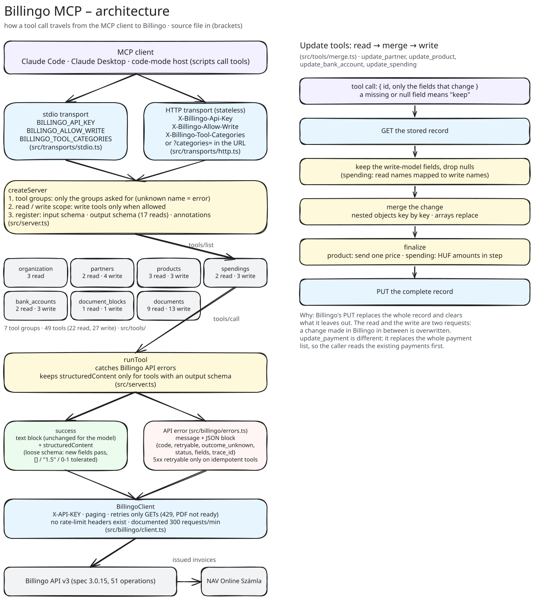

# Architektúra / Architecture

🇭🇺 [Magyar](#magyar) · 🇬🇧 [English](#english)

Az ábra forrása / Diagram source: [`assets/architecture.excalidraw`](assets/architecture.excalidraw).

---

# Magyar

## Az ábra szerkesztése

Nyisd meg az `assets/architecture.excalidraw` fájlt az [excalidraw.com](https://excalidraw.com)
oldalon (Menü → Megnyitás), szerkeszd, mentsd vissza ugyanebbe a fájlba, majd exportáld SVG-be
`assets/architecture.svg` néven. A kettő mindig együtt változzon, hogy az ábra és a
forrása ne térjen el.

## Rétegek

| Réteg            | Fájl                                  | Feladat                                                                                                                                                                                                                       |
| ---------------- | ------------------------------------- | ----------------------------------------------------------------------------------------------------------------------------------------------------------------------------------------------------------------------------- |
| stdio transzport | `src/transports/stdio.ts`             | Asztali MCP klienseknek. Az API kulcsot, az írási jogot és az eszközcsoportokat környezeti változóból olvassa (`BILLINGO_API_KEY`, `BILLINGO_ALLOW_WRITE`, `BILLINGO_TOOL_CATEGORIES`).                                       |
| HTTP transzport  | `src/transports/http.ts`              | Állapotmentes Streamable HTTP. Minden kérés saját szervert kap a kérés fejléceiből (`X-Billingo-Api-Key`, `X-Billingo-Allow-Write`, `X-Billingo-Tool-Categories` vagy `?categories=`), így két ügyfél között semmi sem közös. |
| Szerver          | `src/server.ts`                       | A `createServer` kiválasztja a kért eszközcsoportokat, kiszűri az író eszközöket, ha nincs írási jog, és regisztrálja az eszközöket sémával és jelölésekkel. A `runTool` minden hívást körbevesz.                             |
| Eszközök         | `src/tools/`                          | 7 csoport, 49 eszköz (22 olvasó, 27 író). Egy eszköz egy `defineTool` hívás: név, olvasó vagy író, leírás, bemeneti séma, opcionális kimeneti séma, jelölések, kezelő. A csoportok listája: `src/tools/index.ts`.             |
| Módosítás        | `src/tools/merge.ts`                  | Az `update_*` eszközök közös olvas–összefésül–ír logikája (lásd lent).                                                                                                                                                        |
| Billingo kliens  | `src/billingo/client.ts`              | `X-API-KEY` fejléc, lapozás, ismétlés. Csak a `GET` kéréseket ismétli (429 és még el nem készült PDF esetén), mert egy ismételt írás második számlát állíthatna ki.                                                           |
| Hibák            | `src/billingo/errors.ts`              | Típusos Billingo hibák, és a géppel olvasható hibakód (`code`, `retryable`, `outcome_unknown` …).                                                                                                                             |
| Sémák            | `src/billingo/schemas.ts`, `enums.ts` | Az olvasó eszközök kimeneti sémái és a közös felsorolások (pénznem, áfakulcs, fizetési mód …).                                                                                                                                |

## Egy eszközhívás útja

1. A kliens `tools/list` kérésére a szerver csak a kapcsolatnak engedélyezett eszközöket adja
   vissza. Írási jog nélkül az író eszközök nem is látszanak.
2. `tools/call` kérésnél az SDK a bemeneti séma alapján ellenőrzi az argumentumokat, majd a
   `runTool` meghívja az eszköz kezelőjét.
3. A kezelő a `BillingoClient`-en keresztül hívja a Billingo API-t.
4. Siker esetén a modell szöveges blokkot kap; a kimeneti sémával rendelkező 17 olvasó eszköz
   `structuredContent`-et is ad.
5. Ha a Billingo hibát ad, a `runTool` elkapja, és a hibaüzenet mellé egy JSON blokkot tesz a
   hibakóddal. A szerverhiba (5xx) csak idempotens eszköznél újrapróbálható; máshol
   `outcome_unknown`, mert a művelet akár le is futhatott.

## Módosító eszközök: olvas → összefésül → ír

A Billingo `PUT` kérése a partnernél, terméknél, bankszámlánál és kiadásnál a teljes rekordot
lecseréli, és törli, amit nem kap meg. Ezért az `update_partner`, `update_product`,
`update_bank_account` és `update_spending` maga olvassa ki a rekordot:

1. `GET` a tárolt rekordra.
2. Csak az író modell mezői maradnak, a `null` értékek kiesnek. Kiadásnál az olvasási nevek
   átkerülnek az írási nevekre (`total_gross_local` → `total_gross_huf`, `partner.id` →
   `partner_id`).
3. A megadott mezők rákerülnek: beágyazott objektum kulcsonként, tömb egészben. Hiányzó vagy
   `null` mező: „maradjon”.
4. Utolsó igazítás: termékhez egyetlen ár megy (a megváltozott), kiadásnál a forintos összegek
   a végösszeggel együtt mozognak.
5. `PUT` a teljes rekorddal.

Az olvasás és az írás két külön kérés: ami közben a Billingóban változik, felülíródik. Az
`update_payment` másképp működik: a teljes kifizetéslistát cseréli, ezért előbb a meglévő
kifizetéseket kell kiolvasni.

## Új eszköz hozzáadása

1. `defineTool` a megfelelő `src/tools/<csoport>.ts` fájlban; minden végpontot és mezőt a
   `spec/billingo-3.0.15.json` alapján ellenőrizz.
2. Tedd be a csoport listájába (`src/tools/index.ts` ezt olvassa).
3. Kimeneti séma: lásd a `CLAUDE.md` szabályát.
4. Teszt `tests/tools/` alatt, rögzített válaszokkal (msw), és ha az API viselkedése nem
   egyértelmű, egy éles teszt `tests/live/behaviour.test.ts`-ben.

---

# English

## Editing the diagram

Open `assets/architecture.excalidraw` at [excalidraw.com](https://excalidraw.com)
(Menu → Open), edit it, save it back to the same file, then export it as SVG to
`assets/architecture.svg`. Change both together so the picture never drifts from its
source.

## Layers

| Layer           | File                                  | Job                                                                                                                                                                                                                                     |
| --------------- | ------------------------------------- | --------------------------------------------------------------------------------------------------------------------------------------------------------------------------------------------------------------------------------------- |
| stdio transport | `src/transports/stdio.ts`             | For desktop MCP clients. Reads the API key, the write scope and the tool groups from the environment (`BILLINGO_API_KEY`, `BILLINGO_ALLOW_WRITE`, `BILLINGO_TOOL_CATEGORIES`).                                                          |
| HTTP transport  | `src/transports/http.ts`              | Stateless Streamable HTTP. Every request gets its own server, built from that request's headers (`X-Billingo-Api-Key`, `X-Billingo-Allow-Write`, `X-Billingo-Tool-Categories` or `?categories=`), so nothing is shared between tenants. |
| Server          | `src/server.ts`                       | `createServer` picks the requested tool groups, drops the write tools when writes are not allowed, and registers each tool with its schemas and annotations. `runTool` wraps every call.                                                |
| Tools           | `src/tools/`                          | 7 groups, 49 tools (22 read, 27 write). A tool is one `defineTool` call: name, read or write scope, description, input schema, optional output schema, annotations, handler. The group list is `src/tools/index.ts`.                    |
| Updates         | `src/tools/merge.ts`                  | The shared read–merge–write of the `update_*` tools (see below).                                                                                                                                                                        |
| Billingo client | `src/billingo/client.ts`              | `X-API-KEY` header, paging, retries. Only `GET` requests are retried (on 429 and a PDF that is not ready yet), because a retried write could issue a second invoice.                                                                    |
| Errors          | `src/billingo/errors.ts`              | Typed Billingo errors and the machine-readable error code (`code`, `retryable`, `outcome_unknown` …).                                                                                                                                   |
| Schemas         | `src/billingo/schemas.ts`, `enums.ts` | Output schemas of the read tools and the shared enums (currency, VAT rate, payment method …).                                                                                                                                           |

## The path of a tool call

1. On `tools/list` the server returns only the tools this connection allows. Without the
   write scope the write tools are not listed at all.
2. On `tools/call` the SDK validates the arguments against the input schema, then `runTool`
   calls the tool's handler.
3. The handler calls the Billingo API through `BillingoClient`.
4. On success the model gets a text block; the 17 read tools with an output schema also
   return `structuredContent`.
5. When Billingo returns an error, `runTool` catches it and adds a JSON block with the error
   code next to the message. A 5xx is retryable only on an idempotent tool; anywhere else it
   is `outcome_unknown`, because the operation may have gone through.

## Update tools: read → merge → write

Billingo's `PUT` on partners, products, bank accounts and spendings replaces the whole record
and clears what it is not sent. So `update_partner`, `update_product`, `update_bank_account`
and `update_spending` read the record themselves:

1. `GET` the stored record.
2. Keep only the write model's fields and drop `null` values. For a spending, the read names
   are mapped to the write names (`total_gross_local` → `total_gross_huf`, `partner.id` →
   `partner_id`).
3. Overlay the given fields: nested objects key by key, arrays as a whole. A missing or
   `null` field means "keep".
4. Final adjustment: a product is sent one price (the one that changed); a spending's HUF
   amounts move with its totals.
5. `PUT` the complete record.

The read and the write are two requests: a change made in Billingo in between is
overwritten. `update_payment` works differently: it replaces the whole payment list, so the
caller reads the existing payments first.

## Adding a tool

1. `defineTool` in the matching `src/tools/<group>.ts`; check every endpoint and field
   against `spec/billingo-3.0.15.json`.
2. Add it to the group's list (`src/tools/index.ts` reads it).
3. Output schema: see the rule in `CLAUDE.md`.
4. A test under `tests/tools/` with recorded responses (msw) and, when the API's behaviour is
   not obvious, a live test in `tests/live/behaviour.test.ts`.
